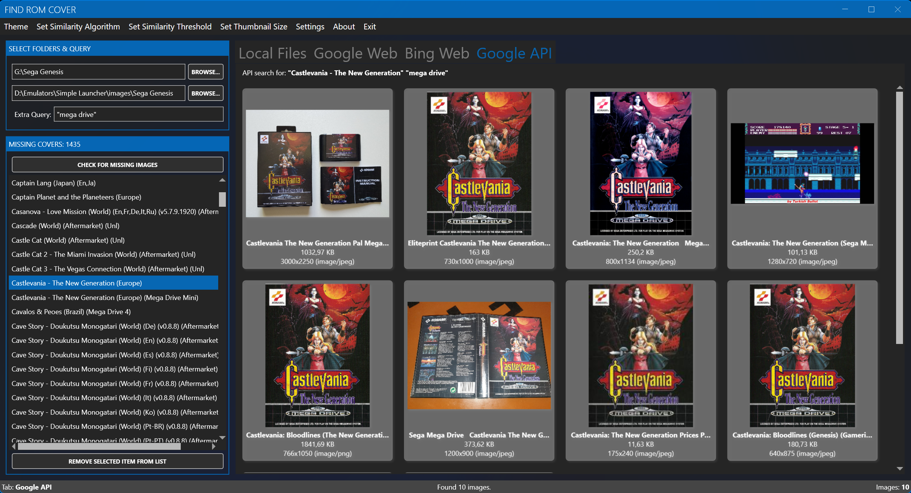

# Quick Start

This walkthrough takes you from a fresh installation to your first saved cover in about five minutes.



## 1. Set your folders

1. Start FindRomCover.
2. Next to **ROM Folder**, click **Browse...** and select the folder that contains your game files.
3. Next to **Image Folder**, click **Browse...** and select the folder where covers are stored.
4. The scan starts automatically when a folder is chosen with a **Browse...** button and both paths are valid. You can re-run it at any time with **Check for Missing Images** or **F5**.

!!! note "Typing a path does not scan"
    Typing a path into a folder box and pressing **Enter** only validates the path and enables the **Check for Missing Images** button. Use **Browse...**, the button, or **F5** to actually run a scan.

The status bar reports how many ROM files matched the supported extensions and how many are missing covers, for example:

```text
Found 412 ROM file(s) matching the supported extensions; 87 missing cover(s).
```

## 2. Pick a missing game

The **Missing Covers** list shows every ROM that has no matching cover image; the header shows `MISSING COVERS: n`. Select an entry to search for it. The selected filename is copied to the clipboard automatically, which makes manual web searches easier.

The buttons below the list are **Remove Selected Item from List** and **AI Fill Missing Covers...**. Right-click an entry for the context menu: remove it from the list, copy the filename, or delete the corresponding ROM/ISO file from disk.

## 3. Find a cover

Use the tabs above the results area:

| Tab | What it does |
|-----|--------------|
| **Local Files** | Ranks images in your image folder by filename similarity using the selected algorithm and threshold (default: Jaro-Winkler, 70%) |
| **Google Web** | Opens a Google image search in an embedded native web view |
| **Bing Web** | Opens a Bing image search in an embedded native web view |
| **Google API** | Shows Google Custom Search results as thumbnails (requires an API key) |

Adjust the search with the **Extra Query** box, for example `box art` or `front cover`. Switching to a tab re-runs its search for the selected game.

## 4. Save the cover

- **Local Files / Google API**: click the image you want. It is converted to PNG if necessary and saved as the sanitized `[gamename].png` in the top level of your image folder.
- **Google Web / Bing Web**: right-click the image in the embedded browser and choose **Save image as...**. Save it in the top level of your image folder using any filename — FindRomCover detects the new file, renames it to the selected game, converts it to PNG, and removes the game from the missing list automatically.

!!! note "Subfolders and existing covers"
    The watcher only looks at the top level of the image folder; images saved into subfolders are ignored. There is no overwrite prompt: existing covers are protected. If the target name is already taken, the new file is renamed to a free name such as `Game (1).png`. For non-PNG sources, if the PNG cover already exists the dropped file is left unchanged and reported as "kept as-is".

The game disappears from the missing list once the cover is in place.

## 5. Optional: let AI pick for you

1. Open `Settings > AI Settings...`.
2. Choose a provider, paste an API key, and click **Test / Load Models** to verify the connection.
3. Enable **AI-assisted image selection**.
4. Back in the main window, use **AI Pick Best** on the Local Files or Google API tab, or **AI Fill Missing Covers...** to process the whole list.

The default OpenRouter model is `google/gemma-4-26b-a4b-it`, which follows the cover/box-art instructions reliably. See [AI Vision Assist](../ai/index.md) and [Recommended Models](../ai/recommended-models.md) for details and cheaper alternatives.

## Related pages

- [Installation](installation.md)
- [Interface Overview](../user-guide/interface.md)
- [Folders & Scanning](../user-guide/folders-and-scanning.md)
- [Local Files Search](../user-guide/local-files.md)
- [Image Handling](../user-guide/image-handling.md)
- [AI Vision Assist](../ai/index.md)
