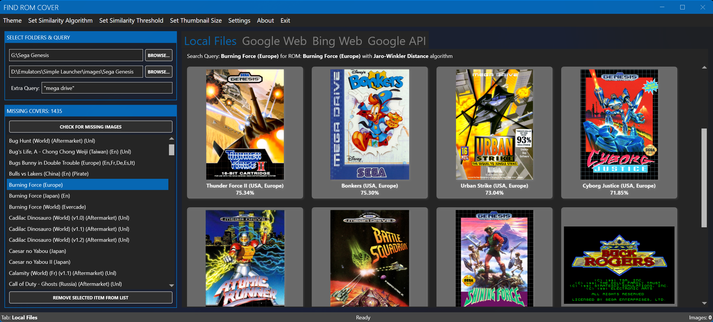

# Interface Overview

The FindRomCover main window is organized around four areas: the menu bar, the folder and query panel, the missing covers list, and the search tabs.

## Menu bar

| Menu | Items | Description |
|------|-------|-------------|
| **Theme > Base Theme** | Light, Dark | Switch the base theme |
| **Theme > Accent Colors** | 20+ colors | Red, Green, Blue, Purple, Orange, Lime, Emerald, Teal, Cyan, Cobalt, Indigo, Violet, Pink, Magenta, Crimson, Amber, Yellow, Brown, Olive, Steel, Mauve, Taupe, Sienna |
| **Set Similarity Algorithm** | Jaccard Similarity, Jaro-Winkler Distance, Levenshtein Distance | Algorithm used to match local image filenames to ROMs (default: Jaro-Winkler) |
| **Set Similarity Threshold** | 10% – 90% | Minimum similarity required to list a local image (default: 70%) |
| **Set Thumbnail Size** | 100 – 500 pixels | Preview size for Local Files results and Google API thumbnails |
| **Settings > API Settings...** | — | Google Custom Search API key |
| **Settings > AI Settings...** | — | AI provider, model, limits, and behavior |
| **Settings > Edit Supported Extensions...** | — | Manage which ROM file extensions are scanned |
| **Settings > Show/Hide Log Window** | — | Toggle the live log viewer |
| **Settings > Use MAME Descriptions** | — | Use MAME descriptions instead of cleaned filenames for searches |
| **Settings > Ignore Bracketed Text in Matching** | On / Off | Ignore text inside `()`, `[]`, and `{}` when matching local image filenames (on by default) |
| **About** | Donate, Check for Updates, About | Support links, update check, and application information |
| **Exit** | — | Close the application (also **Escape**) |

## Folder and query panel

| Control | Purpose |
|---------|---------|
| **ROM Folder** | Root folder of your ROM collection; scanned recursively for supported extensions |
| **Image Folder** | Folder that holds (and receives) cover images; only its top level is used for matching and watching |
| **Extra Query** | Extra words appended to the search query, for example `box art` or `front cover` |
| **Browse...** | Opens a folder picker; choosing a folder with **Browse...** starts an automatic scan when both paths are valid |
| **Check for Missing Images** | Re-scans both folders and rebuilds the missing list (also **F5**) |

Typing a path into a folder box and pressing **Enter** only validates the path and enables the **Check for Missing Images** button; it does not start a scan. The status bar then reports how many ROM files were found and how many are missing covers, for example `Found 412 ROM file(s) matching the supported extensions; 87 missing cover(s).`

## Missing covers list

The list on the left shows every ROM without a cover. Its header shows the current count, for example `MISSING COVERS: 87`. Selecting an entry:

- triggers a search with the currently selected tab;
- copies the ROM filename to the clipboard;
- updates the search query (and the MAME description, if enabled).

Buttons:

| Button | Action |
|--------|--------|
| **Check for Missing Images** (F5) | Re-scans both folders and rebuilds the list |
| **Remove Selected Item from List** | Hides the selected entry without touching any files |
| **AI Fill Missing Covers...** | Runs AI Batch Fill over the whole list (requires AI Assist) |

Right-click context menu:

| Item | Action |
|------|--------|
| **Remove Item from the list** | Hides the entry without touching any files |
| **Copy FileName** | Copies the ROM filename to the clipboard |
| **Delete corresponding ROM or ISO** | Permanently deletes the ROM file from disk after confirmation |

Press **Delete** with an entry selected to remove it from the list.

## Search tabs

| Tab | Result type |
|-----|-------------|
| **Local Files** | Images from your image folder, ranked by filename similarity |
| **Google Web** | Embedded Google image search |
| **Bing Web** | Embedded Bing image search |
| **Google API** | Google Custom Search JSON API results as thumbnails |

Switching to a tab re-runs that tab's search for the selected game: the web tabs re-navigate to the search page, and the Google API tab issues a fresh query and replaces the previous results. The Local Files search runs whenever a game is selected. The status bar shows the active tab name.

## Status bar

The status bar reports the active tab, scan results, active operations, and AI progress. Typical messages:

| Message | Meaning |
|---------|---------|
| `Found 412 ROM file(s) matching the supported extensions; 87 missing cover(s).` | Scan completed; the exact counts replace the example numbers |
| `No ROM files found in "{path}" matching the supported extensions.` | The ROM folder is empty or no file matched the supported extensions |
| `Screenshot saved: <path>` | A screenshot was written by **F8** (see [Screenshots](screenshots.md)) |
| `Screenshot failed. Check the log for details.` | The capture could not be saved |
| AI progress and result messages | Shown while AI pick or batch fill runs |

!!! note
    The number of missing covers is shown in the missing covers list header (`MISSING COVERS: n`), not in the status bar. The right side of the status bar shows the number of images currently displayed in the active tab.

## System tray

Minimizing the window hides it to the system tray instead of the taskbar. Clicking the tray icon restores the window; the tray menu contains **Show** and **Exit**. On Windows 11 a new tray icon may start in the hidden-icons overflow — open the chevron and drag the FindRomCover icon onto the taskbar to keep it visible. If the tray icon cannot be created, minimizing keeps the window in the taskbar instead of hiding it. Balloon notifications are not supported on all platforms and are no-ops — status messages appear in the main window instead.

## Screenshots

Press **F8** to capture the main window to a PNG file. Screenshots are saved to a `Screenshot` folder next to the application; if that folder is not writable (for example under `Program Files`), the per-user data folder is used instead. The status bar shows the saved path. See [Screenshots](screenshots.md) for the naming scheme and details.

## Log window

`Settings > Show/Hide Log Window` opens a live view of the application log with severity, timestamp, and message. It is the fastest way to diagnose problems. Log files are also written to the per-user data folder — see [Logs & Diagnostics](../configuration/logs.md).

## Keyboard shortcuts

The most important shortcuts are **F5** (rescan), **F8** (screenshot), **Delete** (remove selected missing entry), and **Escape** (exit). **Enter** in a folder box only validates the path. See [Keyboard Shortcuts](../reference/keyboard-shortcuts.md) for the full list.

## Related pages

- [Folders & Scanning](folders-and-scanning.md)
- [Local Files Search](local-files.md)
- [Missing Covers List](missing-covers.md)
- [Screenshots](screenshots.md)
- [Keyboard Shortcuts](../reference/keyboard-shortcuts.md)
